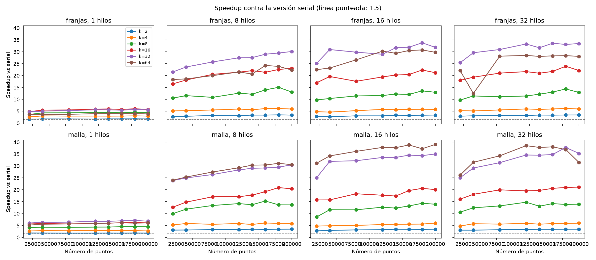
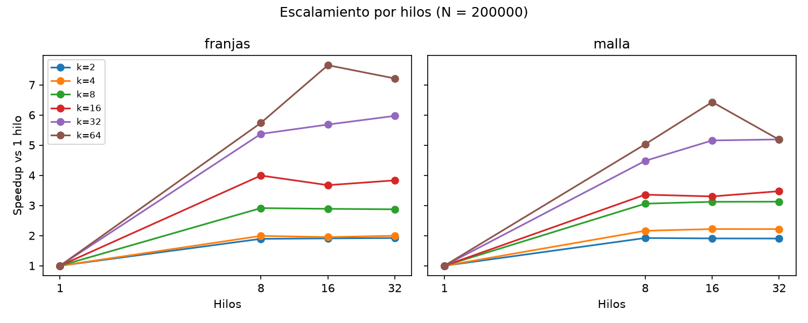
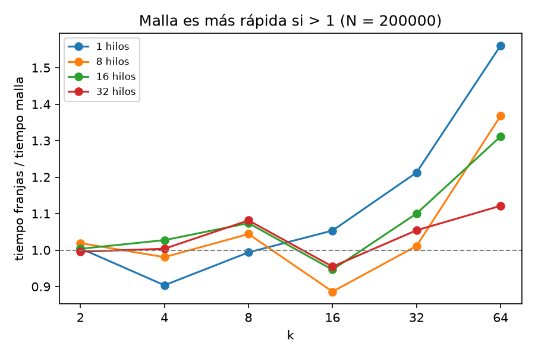

# Evaluación experimental de desempeño

Cómputo Paralelo y en la Nube — Proyecto Apertura: DBSCAN paralelo con OpenMP. Autor del proyecto: Jorge Daniel Lafarga Axotla. Los datos de esta página corresponden a la corrida del 19 de octubre de 2026 en la rama `prueba`.

## Diseño del experimento

Se compararon la versión serial y las versiones paralelas por franjas y por malla. Las versiones paralelas se ejecutaron con `k = {2, 4, 8, 16, 32, 64}` regiones, `N = {20000, 40000, 80000, 120000, 140000, 160000, 180000, 200000}` puntos y `hilos = {1, 8, 16, 32}`. Estos últimos valores son, respectivamente, 1, la mitad, el total y el doble de los 16 procesadores lógicos disponibles. Cada configuración se repitió diez veces: 3,840 corridas paralelas y 80 seriales.

Los CSV de entrada se generaron para cada `N` con los parámetros de `data/DBSCAN_noise.ipynb`: `make_blobs`, cuatro centros, `cluster_std = 0.06`, `random_state = 11`, `center_box = (0, 1.0)`, coordenadas positivas intercambiadas y redondeadas a tres decimales. El algoritmo usa `ε = 0.03` y `min_samples = 10`. Los archivos `data/<N>_data.csv` y `data/<N>_results.csv` se dejaron en el directorio de trabajo; `data/*.csv` está excluido de Git. Cada CSV de salida contiene `x,y,etiqueta`, con `0` para ruido, `1` para core y `2` para core de segundo orden, en el formato que lee la libreta.

`build/dbscan --bench data results/experimentos.csv` midió con `omp_get_wtime` la ejecución del algoritmo, incluida la construcción de las regiones en las versiones paralelas, pero sin incluir la lectura del CSV. El programa comprobó en cada corrida que las etiquetas coincidieran con la versión serial; las 3,920 corridas terminaron sin diferencias. `scripts/graficas.py` calculó las medias por configuración y generó las gráficas. Se usaron estas métricas:

- Speedup contra serial: tiempo medio serial para el mismo `N` dividido entre el tiempo medio de la configuración paralela.
- Speedup por hilos: tiempo medio de la misma versión, `k` y `N` con un hilo dividido entre su tiempo medio con `h` hilos.

El primer cociente incluye la ganancia por dividir los datos en regiones, incluso con un solo hilo. El segundo aísla el efecto de cambiar la cantidad de hilos.

## Equipo y compilación

| Componente | Configuración de esta corrida |
|---|---|
| CPU | Intel Core i5-14450HX, 16 procesadores lógicos visibles (`nproc`) |
| RAM | 15 GiB; 7.6 GiB de swap |
| Sistema | Bazzite 44, kernel `7.2.9-ogc3.1.fc44.x86_64` |
| Compilador | GCC 16.2.1, C++17 y OpenMP |
| Opciones de compilación | `-O3 -march=native -std=c++17 -fopenmp -Wall -Wextra` |

## Resultados

Las siguientes cifras son medias de diez iteraciones. El mejor speedup de cada versión para cada tamaño fue:

| N | Serial (s) | Franjas: mejor speedup (k, hilos) | Malla: mejor speedup (k, hilos) |
|---:|---:|---:|---:|
| 20,000 | 0.0158 | 25.41 (32, 32) | 31.15 (64, 16) |
| 40,000 | 0.0341 | 30.95 (32, 16) | 34.23 (64, 16) |
| 80,000 | 0.0723 | 30.96 (32, 32) | 36.14 (64, 16) |
| 120,000 | 0.1155 | 33.28 (32, 32) | 38.54 (64, 32) |
| 140,000 | 0.1384 | 31.70 (32, 16) | 37.79 (64, 32) |
| 160,000 | 0.1566 | 33.59 (32, 32) | 38.83 (64, 16) |
| 180,000 | 0.1786 | 33.78 (32, 16) | 37.77 (32, 32) |
| 200,000 | 0.1959 | 33.46 (32, 32) | 39.06 (64, 16) |

Para `N = 200,000`, los speedups contra serial de **todas** las configuraciones fueron:

| k | Franjas 1 | Franjas 8 | Franjas 16 | Franjas 32 | Malla 1 | Malla 8 | Malla 16 | Malla 32 |
|---:|---:|---:|---:|---:|---:|---:|---:|---:|
| 2 | 1.80 | 3.40 | 3.43 | 3.45 | 1.81 | 3.47 | 3.44 | 3.43 |
| 4 | 2.99 | 5.94 | 5.82 | 5.96 | 2.70 | 5.83 | 5.98 | 5.98 |
| 8 | 4.49 | 13.08 | 12.97 | 12.90 | 4.47 | 13.66 | 13.93 | 13.95 |
| 16 | 5.78 | 23.05 | 21.21 | 22.13 | 6.08 | 20.43 | 20.07 | 21.13 |
| 32 | 5.61 | 30.12 | 31.85 | 33.46 | 6.80 | 30.46 | 35.04 | 35.28 |
| 64 | 3.89 | 22.34 | 29.78 | 28.07 | 6.08 | 30.56 | 39.06 | 31.48 |

El speedup máximo del experimento fue **39.06**, obtenido por malla con `N = 200,000`, `k = 64` y 16 hilos. Su tiempo medio fue 0.005016 s, frente a 0.195932 s de la serial. Franjas alcanzó un máximo de **33.46** con `N = 200,000`, `k = 32` y 32 hilos, en 0.005855 s. Ambas superan el umbral de 1.5 indicado en la nota del enunciado.

## Interpretación y límites

La partición también acelera con un solo hilo. Por ejemplo, para `N = 200,000` y `k = 32`, el speedup con un hilo es 5.61 en franjas y 6.80 en malla; esa ganancia proviene del menor número de candidatos comparados por punto. Para esta configuración, pasar de 1 a 16 hilos aporta otros factores de 5.68 y 5.15, respectivamente. Por ello, el speedup contra serial no debe atribuirse íntegramente a OpenMP.

`k = 2` crea solo dos regiones y ofrece poco trabajo paralelo. Para `k = 64`, la malla rinde mejor que las franjas en esta entrada: con 16 hilos obtiene 39.06 frente a 29.78. Las franjas angostas requieren halos relativamente grandes; la malla conserva regiones más compactas. Más hilos no garantizan mejores tiempos: con malla y `k = 64`, el speedup baja de 39.06 con 16 hilos a 31.48 con 32.

Se midió una sola semilla, una distribución fija y un solo equipo, sin calentamiento previo. Las diferencias pequeñas pueden reflejar variación del sistema. Además, las mediciones excluyen la lectura de entrada y la escritura de resultados; el experimento caracteriza el cálculo, no el tiempo total de un flujo de archivos.

## Reproducibilidad y archivos

Las 3,920 mediciones individuales están en `results/experimentos.csv`, con columnas `version,k,n,hilos,iteracion,tiempo_s,n_ruido`. Las medias se obtienen agrupando por `version,k,n,hilos`; las imágenes están en `results/speedup_vs_n.png`, `results/speedup_vs_hilos.png` y `results/franjas_vs_malla.png`. Los CSV de puntos y etiquetas en `data/` están disponibles localmente, pero no se incluyen en Git por `.gitignore`; pueden regenerarse con las instrucciones de `README.md`.

## Uso de IA en esta evaluación

La documentación original declara el uso de Claude (Anthropic) para apoyar el diseño y la redacción inicial del proyecto. Para la evaluación de esta página se utilizó Codex (OpenAI) para generar los ocho CSV de entrada con los parámetros de la libreta, ejecutar las 3,920 corridas con el programa existente, comprobar que el experimento terminara sin diferencias respecto a la versión serial y verificar el contenido de los CSV de salida. Codex también ejecutó el script de gráficas, calculó las medias y los speedups a partir de `results/experimentos.csv`, y actualizó las tablas y el análisis de este documento. Los tiempos y resultados numéricos proceden de la ejecución en el equipo descrito arriba.
