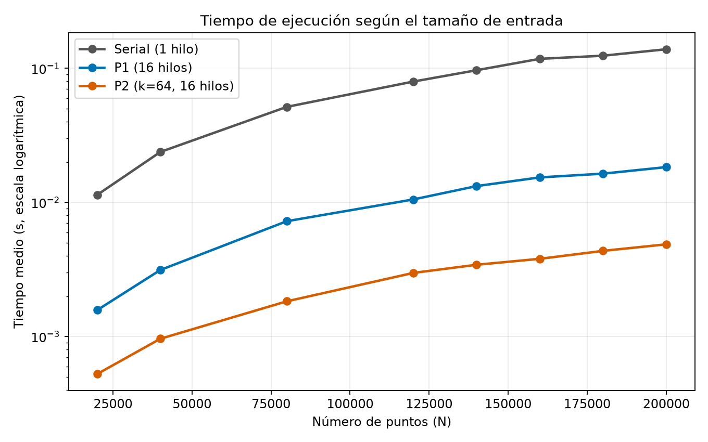
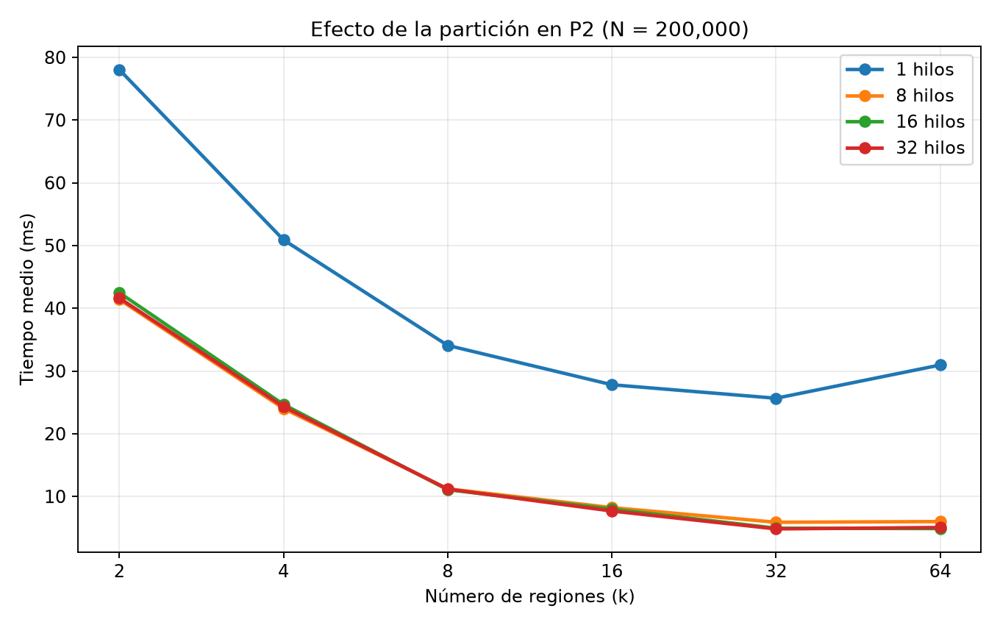
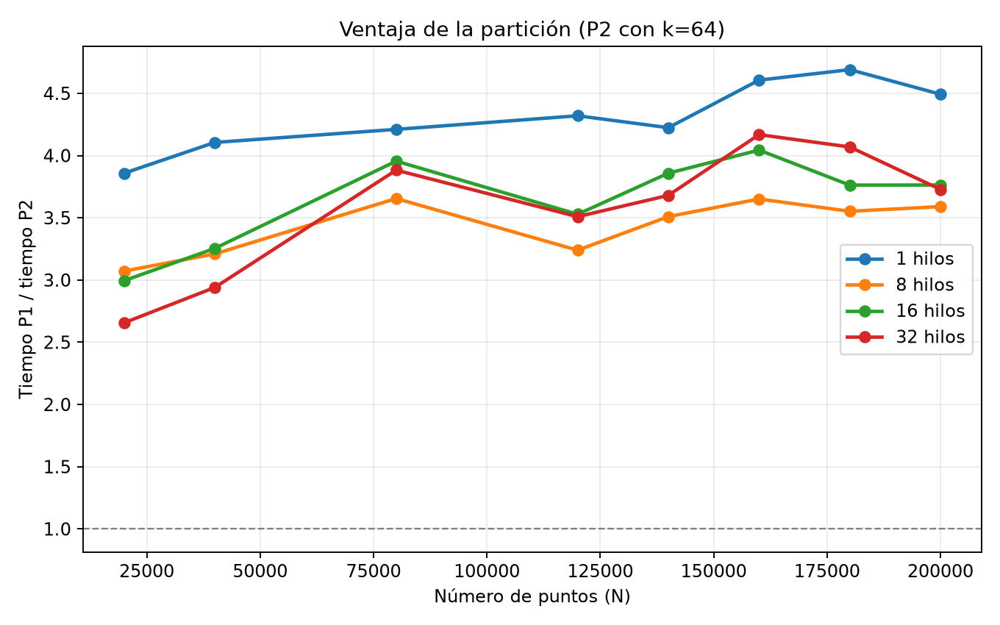

# Evaluación experimental de desempeño

Cómputo Paralelo y en la Nube — Proyecto Apertura: DBSCAN paralelo con OpenMP. Autor del proyecto: Jorge Daniel Lafarga Axotla. Resultados de la corrida del 19 de octubre de 2026.

## Diseño del experimento

Se compararon tres versiones: **serial**, **P1** (paralela sobre todos los puntos, sin partición) y **P2** (paralela con el plano dividido en una malla). Se usaron `N = {20000, 40000, 80000, 120000, 140000, 160000, 180000, 200000}` puntos y `hilos = {1, 8, 16, 32}` para P1 y P2. P2 se midió con `k = {2, 4, 8, 16, 32, 64}` celdas; en P1 y en la serial, `k = 1` indica que se trabaja con la región completa. La serial se midió con un hilo. Cada configuración se repitió diez veces: **80 mediciones seriales, 320 de P1 y 1,920 de P2; 2,320 en total**.

Se reutilizaron los ocho CSV de entrada generados con los parámetros de `data/DBSCAN_noise.ipynb`: `make_blobs`, cuatro centros, `cluster_std = 0.06`, `random_state = 11`, `center_box = (0, 1.0)`, coordenadas positivas intercambiadas y redondeadas a tres decimales. El algoritmo usa `ε = 0.03` y `min_samples = 10`.

`build/dbscan --bench data results/experimentos.csv` midió con `omp_get_wtime` el cálculo, incluida la preparación de la región completa o de la malla. La lectura del CSV y la escritura de resultados quedaron fuera del tiempo medido. En cada corrida el programa comparó las etiquetas con la versión serial; **las 2,320 mediciones terminaron sin diferencias**. Las cifras siguientes son medias de las diez repeticiones de cada configuración.

Se utilizaron dos cocientes:

- **Aceleración frente a serial:** tiempo medio serial para el mismo `N` dividido entre el tiempo medio de P1 o P2.
- **Aceleración al aumentar hilos:** tiempo medio de la misma versión, `k` y `N` con un hilo dividido entre el tiempo medio con `h` hilos.

El primer cociente incluye el efecto de la partición en P2. El segundo permite observar el efecto de aumentar los hilos dentro de una configuración fija.

## Equipo y compilación

| Componente | Configuración de esta corrida |
|---|---|
| CPU | Intel Core i5-14450HX, 10 núcleos y 16 procesadores lógicos visibles |
| RAM | 15 GiB; 7.6 GiB de swap |
| Sistema | Bazzite 44, kernel `7.2.9-ogc3.1.fc44.x86_64` |
| Compilador | GCC 16.2.1, C++17 y OpenMP |
| Opciones de compilación | `-O3 -march=native -std=c++17 -fopenmp -Wall -Wextra` |

## Resultados

El mejor valor de aceleración de cada versión para cada tamaño fue:

| N | Serial (s) | P1: mejor aceleración (hilos) | P2: mejor aceleración (`k`, hilos) |
|---:|---:|---:|---:|
| 20,000 | 0.011387 | 7.33× (32) | 22.54× (32, 16) |
| 40,000 | 0.023794 | 7.58× (16) | 24.66× (64, 16) |
| 80,000 | 0.051597 | 7.11× (16) | 28.14× (64, 16) |
| 120,000 | 0.079649 | 7.56× (16) | 26.68× (64, 16) |
| 140,000 | 0.096755 | 7.32× (32) | 28.18× (64, 16) |
| 160,000 | 0.117666 | **7.66× (32)** | **31.94× (64, 32)** |
| 180,000 | 0.124129 | 7.57× (16) | 29.68× (64, 32) |
| 200,000 | 0.138701 | 7.56× (16) | 28.77× (32, 32) |

La aceleración máxima de todo el experimento fue **31.94×**, obtenida por P2 con `N = 160,000`, `k = 64` y 32 hilos. La máxima de P1 fue **7.66×** con el mismo `N` y 32 hilos. Ambas versiones superaron el umbral de 1.5 indicado en la nota del enunciado.

Para comparar las versiones con la misma cantidad de hilos, la siguiente tabla muestra `N = 200,000`. En P2 se fija `k = 64`, el mayor valor probado:

| Hilos | P1 (s) | Aceleración P1 | P2, `k = 64` (s) | Aceleración P2 |
|---:|---:|---:|---:|---:|
| 1 | 0.139059 | 1.00× | 0.030951 | 4.48× |
| 8 | 0.021512 | 6.45× | 0.005993 | 23.14× |
| 16 | 0.018349 | 7.56× | 0.004876 | 28.45× |
| 32 | 0.018810 | 7.37× | 0.005046 | 27.49× |








## Interpretación y límites

P1 con un hilo tarda prácticamente lo mismo que la serial para `N = 200,000` (0.139059 s frente a 0.138701 s). Con 16 hilos baja a 0.018349 s. Esta comparación muestra la ganancia de repartir entre hilos el trabajo sobre la región completa.

P2 con `k = 64` ya es 4.48 veces más rápida que la serial con un solo hilo para `N = 200,000`, porque cada punto revisa menos candidatos. Al pasar de 1 a 16 hilos, el tiempo de esa misma configuración baja de 0.030951 s a 0.004876 s, una aceleración adicional de 6.35×. Con 16 hilos, P2 tarda 3.76 veces menos que P1 para ese tamaño. Por ello, la ventaja de P2 frente a la serial combina partición y paralelismo.

Aumentar `k` o los hilos no mejora siempre el tiempo. Con `N = 200,000` y 32 hilos, P2 tarda 0.004822 s con `k = 32` y 0.005046 s con `k = 64`. Para `k = 64`, pasar de 16 a 32 hilos también eleva ligeramente el tiempo medio. Construir más regiones y sus halos tiene un costo, y la variación de ejecución influye en diferencias pequeñas.

Se midió una distribución fija de puntos en un solo equipo, sin calentamiento previo. Las diferencias pequeñas pueden reflejar actividad del sistema. Los tiempos excluyen lectura y escritura de archivos, por lo que describen el cálculo y no una ejecución completa de principio a fin.

## Reproducibilidad y archivos

Las **2,320 mediciones individuales** están en `results/experimentos.csv`, con columnas `version,k,n,hilos,iteracion,tiempo_s,n_ruido`. `scripts/graficas.py` agrupa por `version,k,n,hilos` y genera las cuatro imágenes anteriores. Los CSV de entrada en `data/` están disponibles localmente, pero se excluyen de Git mediante `.gitignore`; pueden regenerarse con las instrucciones de `README.md`.

Para repetir el análisis:

```sh
make
build/dbscan --bench data results/experimentos.csv
python3 scripts/graficas.py
```

## Uso de IA en esta evaluación

La documentación original declaraba el uso de Claude (Anthropic) para apoyar el diseño y la redacción inicial del proyecto. En esta actualización se utilizó Codex (OpenAI) para adaptar el script de gráficas, ejecutar el benchmark con P1 y P2, comprobar las etiquetas frente a la serial y actualizar las tablas y el análisis. Los tiempos y resultados numéricos proceden de la ejecución descrita arriba.
